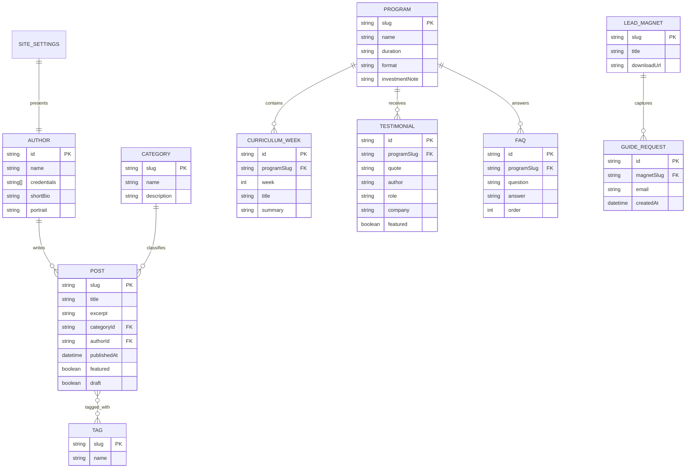

0# The Industry Leader — Website Rebuild Plan

## 0. Context & Decisions

| Item | Decision |
|---|---|
| Domain | `theindustryleader.net` — currently unreachable; ownership/renewal must be confirmed first |
| Positioning | Coaching-first leadership brand for Matthew Ogieva / Business Reimagined Inc. |
| Core offer | 8-week "Becoming an Industry Leader" 1:1 coaching program |
| Audience | Ambitious managers, executives, founders, and professionals who want authority and influence |
| Hosting | Hostinger, static files in `public_html` |
| Architecture | Next.js App Router + TypeScript + static export (`output: 'export'`) |
| Styling | Tailwind CSS v4 + custom design tokens |
| Motion | Framer Motion with reduced-motion support |
| Content | Local MDX + typed TypeScript data files in the repo |
| Forms | Formspree or Web3Forms endpoints (no server) |
| Booking | Cal.com or Calendly link/embed |
| Database | None at runtime. Typed content model + form payload schemas. Optional future Postgres appendix |
| SEO | Metadata API, JSON-LD, sitemap, robots, RSS, 301 redirects, OG images |
| Deployment | `npm run build` → upload `out/` to Hostinger |

**Important trade-off:** because there is no CMS, content updates require editing files and rebuilding. This is acceptable for Phase 1. A Git-based CMS can be added later without rebuilding the architecture.

---

## 1. Product Requirements Document (PRD)

### 1.1 Vision

Position The Industry Leader as the definitive coaching brand for professionals who are already capable but not yet recognised as authorities in their field. The site should feel like a private advisory practice: calm, editorial, credible, and expensive without being flashy.

**Brand promise:**
> Capability gets you into the room. Influence makes you the leader in it.

### 1.2 Goals

1. Convert qualified visitors into discovery-call bookings and program applications.
2. Establish Matthew Ogieva's authority through story, credentials, testimonials, and insights.
3. Replace the lost WordPress site with a faster, more secure, SEO-optimised static site.
4. Preserve existing search equity through redirects and recovered content.
5. Create a scalable content platform for future articles, speaking, and book promotion.

### 1.3 Success Metrics

| Metric | Target |
|---|---|
| Program applications | Primary conversion |
| Discovery-call bookings | Primary conversion |
| Free-guide downloads | Secondary conversion |
| Newsletter signups | Secondary conversion |
| Lighthouse mobile performance | 90+ |
| LCP | < 2.5s |
| CLS | < 0.1 |
| INP | < 200ms |
| Accessibility | No critical Axe issues; WCAG 2.2 AA intent |
| Redirect coverage | 100% of known old URLs |
| Indexed pages | All primary pages + published insights |

### 1.4 Personas

**Persona A — The Overlooked High Performer**
Mid-senior manager, 35–50. Delivers results but is passed over for promotion. Needs clarity, visibility, executive presence, and a plan.

**Persona B — The Founder Seeking Authority**
Founder or consultant, 30–50. Wants to be seen as the go-to expert in their niche to win better clients and higher fees.

**Persona C — The HR / L&D Buyer**
HR or people leader looking for leadership development. Needs credibility, outcomes, and a clear program structure.

### 1.5 Offer Architecture

**Primary:** Becoming an Industry Leader — 8-week 1:1 coaching program.
**Secondary:** Discovery call, free authority guide, newsletter.
**Credibility:** About Matthew, results/testimonials, insights, books, TEDx, media.

### 1.6 Scope — Pages

| Page | URL | Purpose |
|---|---|---|
| Home | `/` | Positioning, proof, program, About, Testimonials, Projects, Insights, Free Guide, Apply, FAQ, conversion |
| Program | `/program/` | Full 8-week program detail |
| Projects | `/projects/` | Case studies and outcome framing |
| Testimonials | `/testimonials/` | All recovered client quotes |
| Contact | `/contact/` | Contact form + booking |
| Insight post | `/insights/[slug]/` | SEO content (listed on the homepage) |
| Thank You | `/free-guide/thank-you/` | Download confirmation |
| Privacy | `/privacy/` | Legal |
| Terms | `/terms/` | Legal |
| Cookies | `/cookies/` | Legal |
| 404 | `/404.html` | Error page |

Retired standalone pages (`/about/`, `/apply/`, `/insights/`,
`/insights/category/<topic>/`, `/free-guide/`, `/results/`) redirect to their
new homepage anchors or replacement page in `public/.htaccess`.

### 1.7 Functional Requirements

| ID | Requirement |
|---|---|
| FR-01 | Responsive header with desktop nav, mobile drawer, and primary CTA |
| FR-02 | Homepage sections with scroll-triggered reveals |
| FR-03 | Program curriculum displayed as an accessible accordion/timeline |
| FR-04 | Multi-step application form with client-side validation |
| FR-05 | Contact form with validation, honeypot, consent, and success/error states |
| FR-06 | Newsletter form in footer and on insights pages |
| FR-07 | Free-guide email capture and thank-you download page |
| FR-08 | Testimonials displayed in a keyboard-accessible carousel/grid |
| FR-09 | Insights index with category filter and client-side search |
| FR-10 | MDX article pages with TOC, author, related posts, and share links |
| FR-11 | Booking CTA linking to Cal.com/Calendly |
| FR-12 | SEO metadata, canonical URLs, OG tags, JSON-LD |
| FR-13 | Sitemap, robots.txt, RSS feed |
| FR-14 | 301 redirects from old WordPress URLs |
| FR-15 | 404 page with useful navigation |
| FR-16 | Optional analytics events for CTAs, forms, and downloads |
| FR-17 | Reduced-motion support and keyboard accessibility |
| FR-18 | Social links and contact details in footer |

### 1.8 Content Requirements

- Verified biography and credentials.
- Program curriculum, format, inclusions, and investment note.
- 3–6 approved testimonials with names, roles, companies, and photos where permitted.
- 6 seed insight articles, original or rewritten with permission.
- Free-guide PDF.
- FAQ answers.
- Privacy, terms, and cookie copy reviewed by the client.
- High-resolution portraits, speaking photos, book covers, and media logos.
- Confirmed claims: avoid "bestselling" or media claims unless substantiated.

### 1.9 Non-Functional Requirements

- Mobile-first, responsive from 320px upward.
- Fast static pages, minimal client JS.
- Semantic HTML and accessible interactions.
- No layout shift from images or fonts.
- No secrets in the client bundle.
- Forms protected with honeypot and provider spam filtering.
- Consistent US English spelling.

### 1.10 Out of Scope — Phase 1

- Custom backend, database, authentication, or CMS.
- Payments/Stripe checkout.
- Client portal or course LMS.
- Multi-language support.
- Live chat.
- Podcast/video hosting.
- E-commerce for books; link to Amazon instead.
- Full migration of old WordPress blog beyond known content.

### 1.11 Assumptions, Risks & Dependencies

| Risk | Mitigation |
|---|---|
| Domain expired or owned by someone else | Confirm ownership immediately; renew or choose a new domain before build |
| Low-resolution recovered assets | Request originals; use recovered assets only as temporary placeholders |
| Unverified claims | Client sign-off on all copy; remove unsupported superlatives |
| Formspree limits | Confirm plan/limits; keep honeypot and provider spam filtering |
| Hostinger shared hosting limitations | Use static export; verify `.htaccess` support |
| No CMS | Document content editing workflow; offer Git-based CMS later |
| Legal copy | Client/legal review before launch |

### 1.12 Launch Criteria

- All pages built and responsive.
- `npm run lint`, `npm run typecheck`, `npm run build` pass.
- Forms tested end-to-end.
- Redirects verified.
- Sitemap and robots live.
- Lighthouse 90+ mobile target.
- No critical accessibility issues.
- Client approves copy, claims, and testimonials.
- Hostinger deployment and SSL confirmed.

---

## 2. Technical Requirements Document (TRD)

### 2.1 Architecture

A fully static Next.js site exported to `out/` and served by Hostinger. No API routes, server actions, middleware, ISR, or runtime image optimisation. All dynamic behaviour is client-side and all content is compiled at build time.

### 2.2 Stack

| Layer | Choice |
|---|---|
| Framework | Next.js 15+ App Router |
| Language | TypeScript |
| Styling | Tailwind CSS v4, CSS-first theme tokens |
| Motion | Framer Motion (`LazyMotion` + `m`) |
| Icons | Lucide React |
| Content | MDX + `gray-matter` + `next-mdx-remote/rsc` |
| Validation | Zod |
| Forms | React Hook Form + Zod resolver |
| Email/forms | Formspree (or Web3Forms) |
| Booking | Cal.com or Calendly |
| SEO | Next Metadata API + JSON-LD + generated sitemap/robots |
| Deployment | Hostinger static hosting |
| Analytics | Optional GA4 or privacy-friendly analytics |

### 2.3 Static Export Constraints

- `next.config.ts`: `output: 'export'`, `trailingSlash: true`, `images: { unoptimized: true }`.
- Dynamic routes must use `generateStaticParams` and `dynamicParams = false`.
- No API routes, server actions, or runtime environment reads.
- Public env vars are baked at build time.
- Sitemap, robots, and RSS are generated by a Node script into `public/` for reliability.
- Images are pre-optimised to WebP/AVIF; `next/image` used with `unoptimized`.
- Hostinger `.htaccess` handles redirects, HTTPS, caching, and 404.

### 2.4 Folder Structure

```text
industry-leader/
├── app/
│   ├── layout.tsx
│   ├── page.tsx
│   ├── about/page.tsx
│   ├── program/page.tsx
│   ├── apply/page.tsx
│   ├── results/page.tsx
│   ├── insights/page.tsx
│   ├── insights/[slug]/page.tsx
│   ├── insights/category/[category]/page.tsx
│   ├── free-guide/page.tsx
│   ├── free-guide/thank-you/page.tsx
│   ├── contact/page.tsx
│   ├── privacy/page.tsx
│   ├── terms/page.tsx
│   ├── cookies/page.tsx
│   ├── style-guide/page.tsx
│   ├── not-found.tsx
│   └── globals.css
├── components/
│   ├── layout/
│   ├── ui/
│   ├── motion/
│   ├── sections/
│   ├── forms/
│   ├── content/
│   └── seo/
├── content/
│   ├── insights/*.mdx
│   ├── legal/*.mdx
│   ├── site.ts
│   ├── author.ts
│   ├── navigation.ts
│   ├── programs.ts
│   ├── testimonials.ts
│   ├── faqs.ts
│   └── lead-magnet.ts
├── lib/
│   ├── content/
│   ├── seo/
│   ├── analytics.ts
│   ├── constants.ts
│   ├── env.ts
│   └── utils.ts
├── public/
│   ├── images/
│   ├── downloads/
│   ├── og/
│   ├── sitemap.xml
│   ├── robots.txt
│   ├── rss.xml
│   └── .htaccess
├── scripts/
│   ├── generate-seo-files.mjs
│   ├── generate-og.mjs
│   └── optimize-images.mjs
├── tests/
├── next.config.ts
├── postcss.config.mjs
├── tsconfig.json
└── package.json
```

### 2.5 Content Pipeline

1. Content lives in `content/` as MDX or typed TS.
2. Each entity has a Zod schema in `lib/content/schemas.ts`.
3. Loaders read and validate content at build time.
4. Invalid content fails the build.
5. MDX is compiled server-side at build time with remark/rehype plugins.
6. `npm run content:check` validates content independently.

### 2.6 Forms & Integrations

| Form | Provider | Destination | Success behaviour |
|---|---|---|---|
| Contact | Formspree | Client email | Inline success message |
| Application | Formspree | Client email | Success state + booking link |
| Newsletter | Formspree | Client email | Inline confirmation |
| Free guide | Formspree | Client email | Redirect to thank-you page |
| Booking | Cal.com/Calendly | External | Opens booking page/embed |

Implementation notes:
- Shared `submitForm` helper.
- Honeypot + submission timing check.
- Consent checkbox linking to privacy page.
- `aria-live` status messages.
- No PII in analytics events.
- Endpoints configured via public env vars.

### 2.7 SEO Implementation

- Canonical host: `https://theindustryleader.net` (non-www).
- Title template: `%s | The Industry Leader`.
- Per-page metadata with title, description, canonical, OG, Twitter.
- JSON-LD: `ProfessionalService`, `Person`, `WebSite`, `Service`, `FAQPage`, `Article`, `BreadcrumbList`.
- Static `sitemap.xml`, `robots.txt`, and `rss.xml`.
- 301 redirects from old WordPress URLs.
- Semantic headings, descriptive alt text, internal linking.
- OG images generated at build time.
- Search Console and Bing verification.
- Avoid `Review`/`AggregateRating` markup unless compliant and genuinely eligible.

### 2.8 Performance Budget

| Asset | Budget |
|---|---|
| Initial JS | < 180KB gzipped |
| Hero image | < 250KB |
| Fonts | 2 families, subset, self-hosted |
| LCP | < 2.5s mobile |
| CLS | < 0.1 |
| Total page weight | < 1.5MB initial |

Techniques:
- `next/font` with subset and `display: swap`.
- Pre-optimised images with explicit dimensions.
- Lazy-load below-fold media.
- `LazyMotion` for Framer Motion.
- Tree-shaken icons.
- No heavy carousel library; CSS scroll-snap.
- Defer analytics.

### 2.9 Accessibility

- Skip link, landmarks, logical heading order.
- Visible focus states.
- Keyboard-accessible nav, accordion, carousel, forms.
- Focus trap and Escape handling in mobile drawer.
- `prefers-reduced-motion` support.
- Color contrast AA.
- Form labels, descriptions, errors, and `aria-live`.
- Alt text for all meaningful images.
- No autoplaying motion or carousels.

### 2.10 Security & Privacy

- No secrets in client code.
- Public form endpoints only.
- Honeypot spam protection.
- Security headers in `.htaccess`.
- HTTPS enforced.
- Privacy policy and consent.
- Analytics only if configured; consent banner if using cookies.

### 2.11 Hostinger Deployment

1. Build: `npm run build`.
2. Upload contents of `out/` to `public_html/`.
3. Ensure `.htaccess` is uploaded.
4. Enable Let's Encrypt SSL.
5. Point domain DNS to Hostinger.
6. Verify non-www canonical and HTTPS redirect.
7. Test forms, booking, and 404.
8. Submit sitemap to Search Console.

### 2.12 Testing & QA

- `npm run lint`
- `npm run typecheck`
- `npm run content:check`
- `npm run build`
- `npx serve out` for local preview.
- Lighthouse mobile audit.
- Axe accessibility scan.
- Playwright smoke tests for navigation, forms validation, insight pages, 404.
- Manual cross-browser checks: Chrome, Safari, Firefox, Edge.
- Responsive checks: 320, 375, 768, 1024, 1440.

### 2.13 Maintenance Workflow

- Add insight: create MDX file, update frontmatter, run content check, rebuild, upload.
- Edit testimonials/FAQs: edit TS data file, rebuild, upload.
- Update assets: replace in `public/images`, rebuild.
- Keep the previous build as a backup before each deployment.
- Optional later: Git-based CMS or headless CMS.

### 2.14 Environment Variables

```env
NEXT_PUBLIC_SITE_URL=https://theindustryleader.net
NEXT_PUBLIC_BOOKING_URL=
NEXT_PUBLIC_FORMSPREE_CONTACT_ENDPOINT=
NEXT_PUBLIC_FORMSPREE_APPLICATION_ENDPOINT=
NEXT_PUBLIC_FORMSPREE_NEWSLETTER_ENDPOINT=
NEXT_PUBLIC_FORMSPREE_GUIDE_ENDPOINT=
NEXT_PUBLIC_ANALYTICS_ID=
```

---

## 3. User Flow

### 3.1 Sitemap

```text
Home
├── About
├── Program
│   └── Apply
├── Results
├── Insights
│   ├── Category
│   └── Post
├── Free Guide
│   └── Thank You
├── Contact
├── Privacy
├── Terms
├── Cookies
└── 404
```

### 3.2 Primary Flows

**Flow A — Program application**
1. Lands on Home or Program from search/referral.
2. Reads outcomes and curriculum.
3. Clicks "Apply for the Program."
4. Completes 3-step application.
5. Submits; sees success state with booking link.
6. Receives email confirmation/next steps.

**Flow B — Free guide**
1. Lands on Home or article.
2. Sees free-guide section.
3. Enters first name + email; consents.
4. Submits; redirected to thank-you page.
5. Downloads PDF; joins newsletter.

**Flow C — Referral / credibility**
1. Visits About or Results.
2. Verifies credentials and testimonials.
3. Clicks "Book a Discovery Call."
4. Opens Cal.com/Calendly and books.

**Flow D — Search visitor**
1. Finds an insight article.
2. Reads article; sees author box and CTA.
3. Moves to Program or Newsletter.

**Flow E — Contact**
1. Visits Contact.
2. Chooses form or booking.
3. Submits; sees confirmation.
4. Receives reply.

### 3.3 Conversion Events

| Event | Trigger |
|---|---|
| `cta_click` | Any primary/secondary CTA |
| `booking_click` | Booking link/embed |
| `form_start` | First field interaction |
| `form_submit` | Valid submit attempt |
| `form_success` | Successful response |
| `form_error` | Failed response |
| `guide_download` | Thank-you download click |
| `newsletter_signup` | Newsletter success |
| `outbound_click` | Amazon/social/media links |
| `faq_open` | Accordion opens |

### 3.4 Edge Cases

- Missing form endpoint: show clear configuration message in development; disable submit in production.
- Network failure: inline error with retry.
- Invalid fields: focus first error; `aria-live` summary.
- No posts in category: friendly empty state.
- Invalid post slug: 404.
- Old URL: 301 redirect.

---

## 4. UI/UX Brief (Branding)

### 4.1 Brand Attributes

**Quiet authority. Editorial. Warm. Disciplined. Human.**
Not a generic corporate consultancy. Not a flashy personal-brand page. The site should feel like a well-designed leadership journal combined with a private advisory practice.

### 4.2 Voice

- Direct, grounded, generous.
- Short sentences; no hype.
- Speak to the reader as a capable peer.
- Use "you" and "we."
- Avoid jargon, clichés, and unsupported superlatives.
- Consistent US English.

### 4.3 Visual Direction

- Light warm-grey backgrounds.
- Charcoal text.
- Gold as the single accent.
- Serif display headlines + clean sans body.
- Generous whitespace.
- Thin rules, editorial numbering, large quotes.
- Subtle grain/texture to avoid flat minimalism.
- Asymmetric image frames and offset gold borders.
- Restrained motion: reveals, fades, slight lifts.

### 4.4 Color System

| Token | Hex | Use |
|---|---|---|
| Ink | `#171717` | Primary text, dark buttons |
| Charcoal | `#242321` | Dark sections |
| Graphite | `#4A4844` | Secondary text |
| Stone | `#6F6B64` | Muted text |
| Mist | `#F4F2EE` | Page background |
| Cloud | `#FAF9F6` | Cards/surfaces |
| Line | `#E2DED6` | Borders/dividers |
| Gold | `#C6A15B` | Primary CTA background |
| Gold Deep | `#8C6A35` | Gold text/links on light |
| Gold Soft | `#E9DCC3` | Soft accents/backgrounds |
| Success | `#2F6B4F` | Success states |
| Error | `#A33A2B` | Errors |

**Contrast rule:** gold buttons use **Ink** text, never white. Gold-deep is used for text links on light backgrounds.

### 4.5 Typography

| Role | Font | Notes |
|---|---|---|
| Display | Fraunces | Headings, quotes, numbers |
| Body/UI | Manrope | Paragraphs, nav, buttons, forms |

Scale:
- H1: `clamp(2.75rem, 6vw, 5rem)`, tight leading, `-0.02em`.
- H2: `clamp(2rem, 4vw, 3.25rem)`.
- H3: `clamp(1.35rem, 2vw, 1.75rem)`.
- Body: `1rem/1.75`.
- Lead: `1.125–1.25rem`.
- Eyebrow: `0.75rem`, uppercase, `0.18em` tracking.
- Prose max width: `68ch`.

### 4.6 Spacing & Layout

- 4px base, 8px rhythm.
- Container: `1200px`; wide: `1360px`; prose: `720px`.
- Gutters: 20/24/32/48.
- Section padding: 64/80/96/128.
- Cards: 24–32px padding, 2px radius max.
- Avoid overly rounded corners; keep edges architectural.

### 4.7 Motion

- Duration: 500–700ms for reveals; 200ms for hover.
- Easing: `[0.22, 1, 0.36, 1]`.
- Reveal: opacity 0→1, y 24→0.
- Stagger: 80ms.
- Hero image: scale 1.03→1.
- Hover: button lift 1px, arrow shift, gold underline grow.
- No autoplay carousels; no parallax on mobile.
- `prefers-reduced-motion`: disable transforms and non-essential motion.

### 4.8 Core Components

- Header with scroll state.
- Mobile drawer with focus trap.
- Buttons: primary gold, secondary outline, ghost, text link.
- Section heading with eyebrow.
- Cards: outcome, testimonial, post, case study.
- Accordion.
- Testimonial carousel with scroll-snap.
- Form fields and validation states.
- Stat/credential strip.
- Logo/credibility marquee.
- TOC and share links.
- Sticky mobile CTA on program page.
- Cookie consent (optional).
- Footer with newsletter.

### 4.9 Page Direction

**Home**
1. Header
2. Hero: portrait, headline, subcopy, two CTAs, trust markers
3. Credibility strip
4. Pain points
5. Outcomes
6. Program preview (dark section)
7. About preview
8. How it works
9. Testimonials
10. Insights preview
11. Free guide
12. FAQ
13. Final CTA
14. Footer

**About:** "A practitioner, not just a theorist." Story, philosophy, credentials, timeline, books/media, CTA.

**Program:** Hero, who it's for/not for, outcomes, 8-week curriculum, inclusions, investment note, testimonials, FAQ, application CTA.

**Apply:** Focused multi-step form with progress indicator and reassurance.

**Results:** "Real leaders. Real shifts." Featured quote, testimonial grid, case studies, CTA.

**Insights:** Editorial index with featured post, categories, search, grid.

**Post:** Breadcrumbs, title, meta, cover, prose, TOC, pull quotes, author box, share, related, CTA.

**Free Guide:** "The Authority Blueprint" lead magnet with cover mockup and email form.

**Contact:** Form + booking + email + location + response time.

### 4.10 Asset Checklist

Recover from Wayback as temporary placeholders:
- Header logo
- About bio portrait
- Home guide image
- Lead generator image
- Three testimonial headshots
- Blog cover
- Favicon

Request from client:
- High-resolution portrait and speaking photos
- Book covers
- Media logos with permission
- Testimonial permissions
- Program details and pricing note
- Legal copy
- Free-guide PDF
- Booking link and form destination email

### 4.11 Key Copy

- Hero H1: **"Become the leader your industry follows."**
- Hero sub: "One-on-one coaching for capable professionals ready to turn expertise into authority, influence, and lasting impact."
- Primary CTA: "Apply for the Program"
- Secondary CTA: "Explore the 8-Week Program"
- Trust line: "25+ years across four continents · TEDx speaker · Author of Conveying Influence"
- Pain headline: "Capability got you here. Authority takes you further."
- Program promise: "In eight weeks, build the clarity, presence, and influence that make you the leader others seek out."
- About headline: "A practitioner, not just a theorist."
- Final CTA: "Your next level is a decision away."
- Free guide: "The Authority Blueprint: Five Shifts That Make You the Leader Your Industry Follows"
- Newsletter: "The Industry Leader Letter"

### 4.12 Program Curriculum

| Week | Theme |
|---|---|
| 1 | The Leader You Are Becoming — identity, vision, leadership brand |
| 2 | Clarity That Commands Attention — positioning, point of view, message |
| 3 | Influence Without Authority — stakeholders, trust, persuasion |
| 4 | Executive Presence & Communication — storytelling, speaking, difficult conversations |
| 5 | Strategic Judgment — decisions, systems thinking, prioritisation |
| 6 | Building High-Performance Teams — culture, accountability, engagement |
| 7 | Ethical Leadership & Reputation — integrity, visibility, legacy |
| 8 | The Industry Leader in Action — 90-day plan, thought leadership, accountability |

**Inclusions:** 8 × 60-minute 1:1 sessions, leadership diagnostic, 90-day roadmap, templates, between-session support, completion review.

**Investment:** "Application-only. Investment and start date are discussed on your discovery call."

---

## 5. Database Schema, Tables & ERD

### 5.1 Note

Phase 1 has **no runtime database**. The "database" is a typed content model stored in the repository and validated at build time. Form submissions are stored by Formspree, not by this site. The ERD below documents the content relationships and the shape of future backend tables.

### 5.2 Content Entities

| Entity | Key fields |
|---|---|
| SiteSettings | name, legalName, tagline, description, url, email, phone, location, bookingUrl, socials, formEndpoints, analyticsId |
| Author | id, name, credentials[], shortBio, longBio, portrait, email, socials[], books[], talks[] |
| Program | slug, name, eyebrow, headline, subheadline, description, duration, format, audience[], outcomes[], curriculum[], includes[], investmentNote, ctaLabel, ctaHref, faqIds[], seo |
| CurriculumWeek | id, week, title, summary, outcomes[] |
| Testimonial | id, quote, author, role, company, location, image, featured, programSlug, tags[], order |
| Post | slug, title, excerpt, category, tags[], publishedAt, updatedAt, authorId, coverImage, coverAlt, featured, draft, seo, body |
| Category | slug, name, description |
| FAQ | id, question, answer, category, order |
| LeadMagnet | slug, title, subtitle, description, coverImage, bullets[], formEndpoint, downloadUrl, seo |
| LegalPage | slug, title, lastUpdated, body |
| NavigationItem | label, href, order, external |

### 5.3 Form Payload Schemas

| Schema | Fields |
|---|---|
| ContactPayload | name, email, phone?, interest, message, consent, source |
| ApplicationPayload | name, email, phone, role, company, location, linkedin?, challenge, outcome, whyNow, tried?, timeCommitment, investmentReadiness, referralSource, consent |
| NewsletterPayload | email, consent, source |
| GuidePayload | firstName, email, consent, source |

### 5.4 Content ERD



### 5.5 Optional Future Postgres Schema — Not Implemented in Phase 1

If a backend is added later, the following tables map cleanly to the content model and form payloads:

`users`, `posts`, `categories`, `tags`, `post_tags`, `programs`, `curriculum_weeks`, `testimonials`, `faqs`, `lead_magnets`, `leads`, `applications`, `subscribers`, `guide_requests`, `legal_pages`, `media`, `site_settings`, `seo_meta`.

This preserves the option to add a CMS or client portal without redesigning the frontend.

---

## 6. Implementation Plan

### 6.1 Working Agreement

- Build vertically, one chunk at a time.
- Every chunk ends with a working build and an integrated page or component.
- No orphaned components.
- Run lint, typecheck, and build after every chunk.
- Keep content and presentation separate.
- No fake claims, testimonials, or metrics.

### 6.2 Chunk Plan

#### Chunk 0 — Project bootstrap & static export
1. Verify Node 20+ and npm.
2. Create Next.js app with TypeScript, Tailwind, ESLint, App Router, `src/`.
3. Install runtime and dev dependencies.
4. Configure static export, trailing slashes, unoptimised images.
5. Add base folder structure, `.env.example`, Prettier.
6. Add `cn` utility and site constants.
7. Verify `npm run build` creates `out/`.

**Done when:** default app builds statically and `out/` is generated.

#### Chunk 1 — Design system & core UI
1. Add color, type, spacing, radius, shadow, and motion tokens.
2. Load Fraunces and Manrope via `next/font`.
3. Build Button, Badge, Card, Container, Section, SectionHeading, Divider, Stat, Prose.
4. Build form primitives: Field, Input, Textarea, Select, Checkbox, FormError, SubmitButton.
5. Build accessible Accordion.
6. Build Reveal, Stagger, StaggerItem, Parallax.
7. Build Header, MobileNav, Footer, SkipLink, Breadcrumbs.
8. Build 404 and internal style guide.
9. Verify responsive, keyboard, and reduced-motion behaviour.

**Done when:** style guide renders all primitives and the shell is usable.

#### Chunk 2 — Content layer
1. Define Zod schemas for all content entities.
2. Add seed content: site settings, author, program, 3 testimonials, 6 FAQs, 6 posts, 2 legal pages, lead magnet.
3. Build content loaders.
4. Build MDX pipeline with remark/rehype.
5. Add reading time, slugs, related posts, categories, TOC extraction.
6. Add `content:check` script.
7. Verify build fails on invalid content.

**Done when:** all content validates and loaders are typed.

#### Chunk 3 — SEO infrastructure
1. Build `buildMetadata` helper.
2. Add JSON-LD components and schemas.
3. Generate `sitemap.xml`, `robots.txt`, `rss.xml` via script.
4. Add default OG image.
5. Add canonical URL and metadata defaults.
6. Add noindex to style guide.

**Done when:** SEO files exist in `public/` and metadata is wired.

#### Chunk 4 — Homepage
1. Build Hero.
2. Build CredibilityStrip.
3. Build PainPoints.
4. Build Outcomes.
5. Build ProgramPreview.
6. Build AboutPreview.
7. Build HowItWorks.
8. Build Testimonials.
9. Build InsightsPreview.
10. Build LeadMagnet.
11. Build FAQ.
12. Build FinalCTA.
13. Wire metadata and JSON-LD.
14. Verify responsive and motion.

**Done when:** complete homepage with all sections and working links.

#### Chunk 5 — About page
1. Build hero.
2. Build story and philosophy.
3. Build credentials and timeline.
4. Build books/media strip.
5. Add Person schema.
6. Add CTA.

**Done when:** About page is complete and linked.

#### Chunk 6 — Program page
1. Build hero.
2. Build who it's for/not for.
3. Build outcomes.
4. Build curriculum accordion/timeline.
5. Build inclusions and investment note.
6. Build testimonials and FAQ.
7. Add Service and FAQPage schema.
8. Add sticky mobile CTA.
9. Link to Apply.

**Done when:** Program page is complete and conversion path works.

#### Chunk 7 — Application flow
1. Define application schema.
2. Build multi-step form with progress.
3. Add validation, honeypot, consent.
4. Add Formspree submission and success/error states.
5. Build `/apply/` page.
6. Add booking link on success.
7. Test validation and submission.

**Done when:** application can be completed and submitted.

#### Chunk 8 — Results page
1. Build hero and stats.
2. Build featured testimonial.
3. Build testimonial grid/filter.
4. Build case study cards.
5. Add CTA.
6. Add metadata.

**Done when:** Results page is complete and linked.

#### Chunk 9 — Insights
1. Build insights index with featured post.
2. Add category filter and client-side search.
3. Build category pages.
4. Build post template with MDX, TOC, author, share, related.
5. Add Article and Breadcrumb schema.
6. Add RSS feed.
7. Verify static generation.

**Done when:** all seed posts render and are indexable.

#### Chunk 10 — Free guide, contact, newsletter, booking
1. Build free-guide page and form.
2. Build thank-you page and PDF download.
3. Build contact page and form.
4. Add booking link/embed.
5. Add footer newsletter form.
6. Add analytics events.
7. Test all forms.

**Done when:** all lead-capture paths work.

#### Chunk 11 — Legal, redirects, deployment
1. Add privacy, terms, cookies.
2. Add `.htaccess` redirects, HTTPS, caching, headers, 404.
3. Build and preview `out/`.
4. Deploy to Hostinger staging.
5. Verify redirects and forms.
6. Enable SSL and DNS.
7. Submit sitemap to Search Console.
8. Run final Lighthouse, Axe, and smoke tests.
9. Write handover notes.

**Done when:** site is live, indexed, and client-approved.

### 6.3 Critical Path

1. Domain ownership/renewal.
2. Hostinger access.
3. Copy and asset approval.
4. Formspree and booking setup.
5. Legal review.
6. Build and QA.
7. DNS/SSL and launch.

### 6.4 Definition of Done

- All pages responsive and accessible.
- Forms tested end-to-end.
- SEO metadata, schema, sitemap, robots, redirects verified.
- Lighthouse 90+ mobile target.
- No critical Axe issues.
- Client approves copy and claims.
- Handover documentation complete.

---

## 7. Appendix — Recovered Old Site Intelligence

The old site was a WordPress/Elementor/Astra build for Business Reimagined Incorporated. Recovered pages and assets include:

**Old pages**
- `/`
- `/about/`
- `/blog/`
- `/contact/`
- `/privacy/`
- `/terms/`
- `/becoming-a-top-1/` (blog post)

**Old asset URLs (Wayback placeholders)**
- `BusinessReimaginedIncorporated_Header_Logos.png`
- `BusinessReimaginedIncorporated_About_Bio.png`
- `BusinessReimaginedIncorporated_Home_Guide.png`
- `BusinessReimaginedIncorporated_Home_LeadGenerator.png`
- `BusinessReimaginedIncorporated_Testimonials_Bankole.jpg`
- `BusinessReimaginedIncorporated_Testimonials_Donald.jpg`
- `BusinessReimaginedIncorporated_Testimonials_Stephen.jpg`
- `BusinessReimaginedIncorporated_Blog_BecomeATop1.jpg`
- `favicon-300x300.png`

**Old testimonial quotes**
- Bankole Adewumi, Boston MA, AVP Data Governance, State Street
- Donald Niesig, New Bedford MA, Owner & CEO, HevyD's Keys Services
- Stephen Parilla, Canton MA, Owner, Restaurant

**Old program promise**
> In my EIGHT WEEKS program, BECOMING AN INDUSTRY LEADER, I'll guide you to take your leadership capabilities to the next level. We'll clarify your vision, map out a proven plan, and execute the strategy to create a framework that serves you and impacts those you lead for years.

**Redirect map**
- `/services/` → `/program/`
- `/about/` → `/#about`
- `/apply/` → `/#apply`
- `/insights/` and `/insights/category/<topic>/` → `/#insights`
- `/free-guide/` → `/#free-guide`
- `/results/` → `/projects/`
- `/blog/` → `/#insights`
- `/becoming-a-top-1/` → `/insights/becoming-a-top-1/`
- `/feed/` → `/rss.xml`
- `/comments/feed/` → `/rss.xml`
- `/sitemap.rss` → `/sitemap.xml`
- `/wp-admin/` → 410
- `/wp-login.php` → 410
- `/wp-json/` → 410
